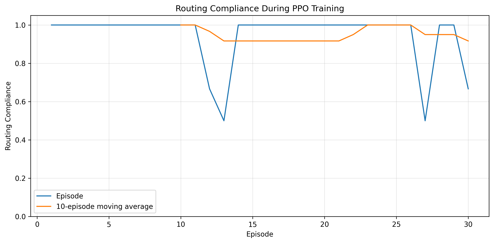

# Privacy-Aware LLM Routing

A privacy-aware LLM routing framework that dynamically routes sensitive and non-sensitive text chunks between local and remote LLM inference.

Inspired by the Privacy-R1 approach, this project combines PII detection, privacy-aware preprocessing, transformer-based actor-critic policy learning, supervised warm-up, and PPO reinforcement learning.

The routing objective is:

- **PII-containing chunks → LOCAL**
- **Non-PII chunks → REMOTE**

The system is designed to balance privacy protection, task performance, routing compliance, and practical remote LLM utilization.

## Why this project

Sending prompts to remote LLM providers can expose sensitive information when inputs contain personally identifiable information (PII).

This project addresses the problem through privacy-aware, chunk-level routing. Sensitive chunks are identified before routing, and a hard privacy constraint ensures that PII-sensitive chunks remain local while the learned policy determines routing behavior for suitable non-sensitive content.

The framework optimizes multiple objectives:

- Privacy leakage minimization
- Task performance
- Routing compliance
- Remote model utilization

---

## Research Highlights

- Designed a chunk-level privacy-aware routing framework for hybrid local/remote LLM inference.
- Combined PII detection with a transformer-based actor-critic routing policy.
- Used supervised warm-up to initialize the policy before PPO fine-tuning.
- Designed a reward function incorporating privacy leakage, task gain, routing compliance, and remote usage.
- Implemented a hard privacy constraint that overrides learned actions for PII-sensitive chunks.
- Included evaluation and ablation utilities for analyzing routing behavior.

---

## Overview

Sending user prompts to remote LLM providers can expose sensitive information when the input contains personally identifiable information (PII).

This project addresses the problem by processing an input prompt as multiple chunks and making privacy-aware routing decisions for each chunk.

The pipeline:

1. Preprocesses and chunks the input.
2. Detects PII and sensitive entities.
3. Generates embeddings using MiniLM.
4. Encodes chunk representations using a transformer-based policy.
5. Predicts routing actions using an actor-critic architecture.
6. Enforces a hard privacy constraint so PII-containing chunks remain local.
7. Computes a reward based on privacy leakage, task gain, and routing compliance.
8. Performs supervised warm-up.
9. Fine-tunes the routing policy using PPO.
10. Evaluates the trained policy using privacy and routing metrics.

---

## Key Features

- PII and sensitive entity detection
- Quasi-identifier detection
- Clinical-style named entity recognition
- Privacy-aware preprocessing and anonymization
- MiniLM-based chunk embeddings
- Transformer-based routing policy
- Actor-critic architecture
- Supervised policy warm-up
- PPO reinforcement learning
- Local/remote hybrid LLM routing
- Hard privacy constraint for PII chunks
- Privacy leakage evaluation
- Routing compliance evaluation
- Remote routing ratio analysis
- Task-gain evaluation
- Ablation analysis
- Training and evaluation visualizations
- Saved PPO routing-agent checkpoint

---

## Core Architecture

```text
                    Input Prompt
                         │
                         ▼
                Text Preprocessing
                         │
                         ▼
                     Chunking
                         │
                         ▼
              PII / Sensitive Entity
                    Detection
                         │
                         ▼
                 MiniLM Embeddings
                         │
                         ▼
              Transformer Encoder
                         │
                         ▼
             Actor-Critic Policy
                    │       │
                    │       └── Value / Critic
                    │
                    ▼
               Routing Action
                    │
          ┌─────────┴─────────┐
          │                   │
     PII / Sensitive       Non-PII
          │                   │
          ▼                   ▼
        LOCAL               REMOTE
        LLM                   LLM
          │                   │
          └─────────┬─────────┘
                    ▼
             Reward Function
                    │
                    ▼
               PPO Training
```

---

### Routing Decision

The transformer policy produces a candidate routing action for each chunk. A hard privacy layer then verifies the routing decision. If a chunk is identified as PII-sensitive, the final action is forced to **LOCAL**, overriding the learned action.

This separates **policy learning** from **privacy enforcement**.

---

## Routing Policy

The routing policy is designed around a privacy-aware constraint:

```text
PII-containing chunk      → LOCAL
Non-PII chunk              → REMOTE
```

The learned policy optimizes the trade-off between:

- Privacy leakage
- Task gain
- Routing compliance
- Remote model utilization

A hard privacy constraint prevents PII-containing chunks from being intentionally routed to the remote model.

---

## Training Pipeline

### Phase 1 — Dataset Preparation

```text
src/phase1_dataset.py
```

Loads and prepares the training, validation, and test data.

---

### Phase 2 — Privacy Preprocessing

```text
src/phase2_preprocessing.py
```

Performs privacy-related preprocessing, entity detection, and sensitive-span handling.

---

### Phase 3 — Privacy-R1 Agent

```text
src/phase3_agent.py
```

Defines the transformer-based actor-critic routing policy.

The policy contains:

- Positional encoding
- Transformer encoder layers
- Actor head for routing actions
- Critic head for value estimation

---

### Phase 4 — Reward Function

```text
src/phase4_reward.py
```

Computes the reinforcement-learning reward using privacy and task-related signals.

The reward considers:

- Privacy leakage
- Task gain
- Routing compliance
- Remote usage

---

### Phase 5 — Hybrid Rollout

```text
src/phase5_rollout.py
```

Executes routing decisions and interacts with the local and remote LLM components.

---

### Phase 6 — Supervised Warm-Up

```text
src/phase6_warmup.py
```

Generates heuristic routing labels based on privacy information and provides an initial policy before PPO training.

---

### Phase 7 — PPO Training

```text
src/phase7_ppo.py
```

Fine-tunes the routing policy using **Proximal Policy Optimization (PPO)**.

---

# Repository Structure

```text
Privacy-Aware-LLM-Routing/
│
├── data/
│   ├── train.json
│   ├── validation.json
│   ├── test.json
│   └── gold_responses.json
│
├── evaluation/
│   ├── ablation.py
│   ├── baselines.py
│   ├── evaluate.py
│   ├── merge_evaluations.py
│   ├── metrics.py
│   ├── plot_results.py
│   ├── routing_test.py
│   ├── sanity_test.py
│   ├── split_dataset.py
│   └── validate_dataset.py
│
├── models/
│   └── privacy_r1_agent.pt
│
├── results/
│   ├── figures/
│   │   ├── privacy_leak_curve.png
│   │   ├── remote_ratio_curve.png
│   │   ├── reward_curve.png
│   │   ├── routing_compliance_curve.png
│   │   └── task_gain_curve.png
│   │
│   ├── raw/
│   │   ├── ablation.json
│   │   ├── ppo_summary.json
│   │   ├── ppo_training.csv
│   │   ├── routing_evaluation.json
│   │   ├── test_end_to_end.json
│   │   ├── test_evaluation.json
│   │   ├── test_remote_000_050.json
│   │   ├── test_remote_050_100.json
│   │   └── validation_evaluation.json
│   │
│   └── tables/
│       └── final_output.json
│
├── scripts/
│   └── prepare_clinical_data.py
│
├── src/
│   ├── openai_compatible.py
│   ├── phase1_dataset.py
│   ├── phase2_preprocessing.py
│   ├── phase3_agent.py
│   ├── phase4_reward.py
│   ├── phase5_rollout.py
│   ├── phase6_warmup.py
│   ├── phase7_ppo.py
│   └── privacy.py
│
├── tests/
│   └── test_privacy.py
│
├── .env.example
├── .gitignore
├── evaluate.py
├── main.py
├── Privacy_R1.ipynb
├── README.md
├── requirements.txt
├── sanity_test.py
├── sanitytest.py
└── test_remote.py
```

---

# Installation

## 1. Clone the repository

```bash
git clone https://github.com/<your-username>/Privacy-Aware-LLM-Routing.git
cd Privacy-Aware-LLM-Routing
```

---

## 2. Create a virtual environment

### Windows PowerShell

```powershell
python -m venv .venv
.venv\Scripts\Activate.ps1
```

### macOS / Linux

```bash
python3 -m venv .venv
source .venv/bin/activate
```

---

## 3. Install dependencies

```bash
pip install -r requirements.txt
```

Install the required spaCy model:

```bash
python -m spacy download en_core_web_sm
```

---

# Remote Provider Setup

The project supports Hugging Face or any OpenAI-compatible provider. An
OpenAI-compatible provider is preferred when Hugging Face inference credits are
unavailable.

## 1. Create `.env`

Copy the provided environment template.

### Windows PowerShell

```powershell
copy .env.example .env
```

### macOS / Linux

```bash
cp .env.example .env
```

Then edit `.env`:

```env
HF_TOKEN=your_huggingface_token_here
```

For the selected Groq provider, set these values instead:

```env
LLM_API_KEY=your_groq_api_key_here
LLM_API_BASE=https://api.groq.com/openai/v1
REMOTE_MODEL=openai/gpt-oss-120b
JUDGE_MODEL=allam-2-7b
```

The provider must expose an OpenAI-compatible `/chat/completions` endpoint and
support the selected model. Do not commit `.env` or any real API key.

Replace the placeholder with your own Hugging Face access token.

### Security

**Never commit your actual Hugging Face token.**

The repository intentionally contains:

```text
.env.example
```

but excludes:

```text
.env
```

through `.gitignore`.

The token is loaded through an environment variable rather than being hard-coded into the source code.

---

# Dataset

The repository contains:

```text
data/
├── train.json
├── validation.json
├── test.json
└── gold_responses.json
```

Each training/validation/test record is expected to contain the required fields:

```text
query
pii_units
target_response
```

The training pipeline validates the dataset schema before training.

The included data is intended for research and experimentation. Do not add real personally identifiable or confidential information to the repository.

---

# Running the Project

## Quick Smoke Test

Run a minimal training execution:

```bash
python main.py --steps 2 --warmup-epochs 1 --ppo-batch-size 2 --ppo-epochs 1
```

This is useful for verifying the pipeline and configuration.

---

## Standard Training Run

Example:

```bash
python main.py --steps 300 --warmup-epochs 1 --ppo-batch-size 8 --ppo-epochs 4
```

---

## Useful Arguments

```text
--train-file data/train.json
--skip-warmup
--no-debug-rollout
--seed 42
```

For all available arguments:

```bash
python main.py --help
```

---

# Evaluation

## 1. Full Pipeline Sanity Test

```bash
python evaluation/sanity_test.py
```

---

## 2. Routing Boundary Test

Tests the privacy routing boundary and verifies that PII-containing chunks are kept local.

```bash
python evaluation/routing_test.py
```

---

## 3. Policy Evaluation

```bash
python evaluation/evaluate.py data/validation.json --output results/raw/validation_evaluation.json
```

Evaluate the saved routing checkpoint on the held-out test set. This uses the
production sentence chunker, the shared PII detector, and deterministic action
selection after the hard privacy constraint:

```bash
python evaluation/evaluate.py data/test.json --checkpoint models/privacy_r1_agent.pt --device cpu --output results/raw/test_evaluation.json
```

To measure generated-answer quality as well as routing metrics, add
`--with-task-gain`. This requires Hugging Face access and runs the local model,
remote model, and remote judge:

```bash
python evaluation/evaluate.py data/test.json --checkpoint models/privacy_r1_agent.pt --device cpu --with-task-gain --output results/raw/test_end_to_end.json
```

Large evaluations can be resumed in disjoint batches. Run the first and second
halves separately, then merge them:

```bash
python evaluation/evaluate.py data/test.json --checkpoint models/privacy_r1_agent.pt --device cpu --with-task-gain --start-index 0 --max-samples 50 --output results/raw/test_remote_000_050.json
python evaluation/evaluate.py data/test.json --checkpoint models/privacy_r1_agent.pt --device cpu --with-task-gain --start-index 50 --max-samples 50 --output results/raw/test_remote_050_100.json
python -m evaluation.merge_evaluations results/raw/test_remote_000_050.json results/raw/test_remote_050_100.json --output results/raw/test_end_to_end.json
```

When Hugging Face inference credits are unavailable, use the local fallback.
It uses the local model for both routes and MiniLM similarity for task scoring:

```bash
python evaluation/evaluate.py data/test.json --checkpoint models/privacy_r1_agent.pt --device cpu --with-task-gain --offline-task-gain --output results/raw/test_offline_end_to_end.json
```

---

## 4. Ablation Analysis

```bash
python evaluation/ablation.py data/test.json --checkpoint models/privacy_r1_agent.pt --device cpu --output results/raw/ablation.json
```

The ablation report includes privacy leakage, remote routing ratio, routing
compliance, and privacy reduction relative to all-remote routing.

---

## 5. Dataset Validation

```bash
python evaluation/validate_dataset.py data/train.json
```

---

## 6. Generate Training Plots

```bash
python evaluation/plot_results.py
```

---

## 7. Test Remote Hugging Face Access

```bash
python test_remote.py
```

## 8. Automated Privacy Tests

```bash
python -m unittest discover -s tests -v
```

---

# Results

### Comprehensive Evaluation Benchmark (100-Sample Test Set)

The table below summarizes the test set evaluation comparing baselines against the trained Privacy-R1 agent, including the full end-to-end evaluation with real local generation, remote inference, and remote LLM judge scoring:

| Policy / Evaluation Mode | Privacy Leakage | Remote Ratio | Routing Compliance | Task Gain | Reward | Successful Rollouts |
| :--- | :---: | :---: | :---: | :---: | :---: | :---: |
| **All-Local Baseline** | 0.00% | 0.00% | 18.83% | — | — | 100/100 |
| **All-Remote Baseline** | 35.00% | 100.00% | 81.17% | — | — | 100/100 |
| **Heuristic Baseline** | 3.00% | 81.17% | 100.00% | — | — | 100/100 |
| **Trained Privacy-R1 (Policy Evaluation)** | **0.00%** | **76.50%** | **95.33%** | — | — | 100/100 |
| **Trained Privacy-R1 (End-to-End Remote)** | **0.00%** | **72.00%** | **90.83%** | **0.97** | **1.1517** | **100/100** |

> [!NOTE]
> **Why are Task Gain and Reward marked with `—` in the first four rows?**
> - **Rows 1–4 (Pure Routing Policy Evaluation):** These evaluate chunk-level routing decisions (privacy leakage, remote offload percentage, and routing compliance) deterministically without calling generative LLMs or the LLM Judge. Because no text answer is synthesized, there is no generated response to score — therefore Task Gain and Reward are not applicable (`—`).
> - **Row 5 (End-to-End Remote Rollout):** Runs the full generative pipeline across all 100 test samples — generating text locally with `Qwen2.5-0.5B-Instruct` for sensitive chunks, calling the remote LLM (`openai/gpt-oss-120b` via Groq) for safe chunks, merging outputs, and scoring answer accuracy with the remote LLM Judge (`allam-2-7b`). It demonstrates an outstanding **0.97 (97%) task gain** and **1.1517 reward** with **0.00% privacy leakage**.

> **Key Findings:**
> - **Zero Privacy Leakage (0.00%):** The hard privacy constraint guarantees that sensitive/PII data is never leaked to the remote provider.
> - **High Remote Offloading (72.0% - 76.5%):** Non-sensitive chunks are effectively routed to the remote model for heavy inference.
> - **Exceptional Answer Quality (0.97 Task Gain):** Evaluated across 100 clinical queries with the LLM judge, the hybrid generated responses achieved a 97% task quality score.
> - **100% Rollout Reliability:** 100 out of 100 test samples completed without failures.

---

The project also includes visualizations from the recorded training and evaluation runs.

The evaluation analyzes:

- Privacy leakage
- Routing compliance
- Remote routing ratio
- Reward progression
- Task gain
- Ablation behavior

These visualizations are provided to illustrate the behavior of the implemented routing policy across the recorded experiments.

## Privacy Leakage


---

## Remote Routing Ratio


---

## Reward


---

## Routing Compliance



---

## Task Gain


> **Note:** The visualizations represent results from the included experimental runs. They are provided for demonstration and reproducibility purposes and should not be interpreted as formal guarantees of privacy, utility, or generalization.

---

# Trained Model

A trained Privacy-R1 routing-agent checkpoint is included at:

```text
models/privacy_r1_agent.pt
```

The checkpoint contains the learned parameters of the transformer-based actor-critic routing agent, including:

- Positional encoding
- Transformer encoder layers
- Actor head
- Critic head

The checkpoint can be used for evaluation without retraining the routing policy from scratch.

---

# Output Files

Training and evaluation outputs include:

```text
models/privacy_r1_agent.pt

results/
├── figures/
│   ├── privacy_leak_curve.png
│   ├── remote_ratio_curve.png
│   ├── reward_curve.png
│   ├── routing_compliance_curve.png
│   └── task_gain_curve.png
│
├── raw/
│   ├── ablation.json
│   ├── ppo_summary.json
│   ├── ppo_training.csv
│   ├── routing_evaluation.json
│   ├── test_end_to_end.json
│   ├── test_evaluation.json
│   ├── test_remote_000_050.json
│   ├── test_remote_050_100.json
│   └── validation_evaluation.json
│
└── tables/
    └── final_output.json
```

---

# Technologies

- Python
- PyTorch
- Transformers
- Hugging Face Hub
- Sentence Transformers
- spaCy
- Microsoft Presidio
- NumPy
- Pandas
- Scikit-learn
- Matplotlib

---

# Privacy and Security

This project focuses on privacy-aware LLM routing.

Important security practices include:

- PII detection before routing
- Hard local routing for PII-containing chunks
- Environment-variable based credential management
- `.env` excluded from version control
- `.env.example` provided for configuration
- No API tokens embedded in source code
- Synthetic/research data used for repository examples

### Important limitation

PII detection systems can produce false positives and false negatives. Therefore, the routing mechanism should not be interpreted as a universal privacy guarantee.

For production deployment, additional privacy controls, auditing, access controls, encryption, and security testing would be required.

---

# Reproducibility

Results can vary between runs because of:

- PPO stochasticity
- Random initialization
- GPU execution
- Remote model/provider behavior
- Provider availability and quotas
- Dataset differences
- Model version changes

For meaningful comparisons, use the same:

- Dataset splits
- Model configuration
- Training parameters
- Evaluation configuration

The included checkpoint and evaluation outputs are provided to make the reported experiment easier to reproduce.

---

# Troubleshooting

### Hugging Face token error

If you receive an error indicating that the Hugging Face token is missing:

1. Make sure `.env` exists.
2. Check that it contains:

```env
HF_TOKEN=your_actual_token
```

3. Make sure the token is valid.
4. Run:

```bash
python test_remote.py
```

---

### Missing spaCy model

Run:

```bash
python -m spacy download en_core_web_sm
```

---

### Remote provider/API error

Remote inference may fail because of:

- Invalid credentials
- Provider availability
- Account limitations
- Model availability
- Network issues
- Provider quotas

Check your Hugging Face account and model/provider access.

---

# Project Status

This repository contains a research-oriented implementation of privacy-aware LLM routing, including:

- Privacy preprocessing
- Transformer-based routing
- Supervised warm-up
- PPO fine-tuning
- Hybrid local/remote inference
- Evaluation
- Ablation analysis
- Training visualizations
- Trained routing-agent checkpoint

The implementation is intended for research, experimentation, and educational use.

---

# License

No open-source license has currently been specified.

If this project is released publicly for reuse, an appropriate license should be added to the repository.
